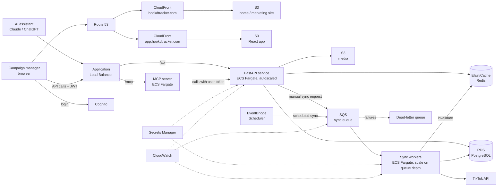

# Hookd Tracker — Project Plan

> **Hookd Tracker: every creator, every target, every TikTok post, tracked in one dashboard.**

---

## 1. Problem

UGC campaign managers run campaigns with many creators at once. To check whether each creator is posting enough and performing well, they open each creator's TikTok account one by one, count posts against what was agreed, and copy metrics into spreadsheets. This is slow, error-prone, and gets worse with every creator and campaign added.

**Hookd Tracker** puts campaigns, creators, targets and post performance in one platform, so a manager can see at a glance who is on target, who is behind, and how each campaign is performing.

---

## 2. Users

| User | Description | Needs |
|---|---|---|
| **UGC campaign manager** (primary, B2B) | Runs TikTok UGC campaigns for brands, managing a roster of creators | One place to manage campaigns and creators, track posts vs targets, and see performance without checking accounts manually |

**Platform:** TikTok only (first version).

---

## 3. Scope

### In scope (A3)
- Single user type: UGC campaign manager
- Campaign management (CRUD)
- Creator roster (CRUD), assignment to campaigns, per-period post targets
- Automatic TikTok post and metrics sync, plus manual post entry
- Campaign dashboard, creator view, behind-target flags
- Public home page
- **Extension beyond the A3 spec:** MCP server exposing campaign and creator tools to AI assistants

### Future scope (commercial roadmap)
- AI post-to-campaign matching, AI campaign summaries, drafted creator follow-ups
- Agent-to-agent workflows (ACP)
- Instagram, YouTube and other platforms
- Team invites, roles and multi-user organisations
- Creator portal
- Dashboard filters, report exports (CSV/PDF), automated alerts
- Creator fees and payment tracking
- Full marketing site with features, pricing and blog (SEO)

### Out of scope
- Content approval workflows and creative briefs

### Scope statement
Hookd Tracker is a web platform for UGC campaign managers to manage TikTok campaigns and creators in one place. Managers create campaigns, assign creators with posting targets, and track each creator's posts and performance automatically, replacing manual checks across individual TikTok accounts. The first version supports a single user type and TikTok only, and includes an MCP server so managers can query their campaign data from an AI assistant.

---

## 4. Data Model

| Entity | Key fields |
|---|---|
| **User** (campaign manager) | id, name, email, organisation_id, cognito_sub |
| **Campaign** | id, organisation_id, name, brand, start_date, end_date, status, tracking_hashtags |
| **Creator** | id, organisation_id, name, platform, handle, niche, contact |
| **CampaignCreator** (assignment) | id, campaign_id, creator_id, target_posts, target_period (week/month), status |
| **Post** | id, creator_id, campaign_id, platform, url, caption, hashtags, posted_at, views, likes, comments, shares, match_source, last_synced_at |

**Design notes**
- Targets live on **CampaignCreator**, not Creator — the same creator can have different targets in different campaigns.
- `organisation_id` is included now (one user per org) so teams can be added later without migrating data.
- `platform` on Creator and Post (default `tiktok`) leaves room for Instagram and YouTube.
- `match_source` on Post (`hashtag` / `manual`, later `ai`) tracks how a post was linked to a campaign.
- Raw `caption` and `hashtags` are stored so future AI features have content to work with.

---

## 5. User Stories

**Priority:** MVP = A3 core · Extension = in scope, beyond the A3 spec · Future = commercial roadmap

### Epic 1: Account
| ID | User story | Priority |
|---|---|---|
| US-01 | As a manager, I can sign up and log in so my campaign data is private to me. | MVP |
| US-02 | As a manager, I can log out and stay signed in securely between sessions. | MVP |

### Epic 2: Campaign management
| ID | User story | Priority |
|---|---|---|
| US-03 | As a manager, I can create a campaign with a name, brand, start and end date, and tracking hashtags. | MVP |
| US-04 | As a manager, I can edit a campaign's details when the brief changes. | MVP |
| US-05 | As a manager, I can archive or delete a campaign that has ended or was cancelled. | MVP |
| US-06 | As a manager, I can see a list of all my campaigns with status and overall progress at a glance. | MVP |

### Epic 3: Creator management
| ID | User story | Priority |
|---|---|---|
| US-07 | As a manager, I can add a creator with their name, TikTok handle, niche and contact details. | MVP |
| US-08 | As a manager, I can edit or remove a creator from my roster. | MVP |
| US-09 | As a manager, I can assign creators to a campaign. | MVP |
| US-10 | As a manager, I can set each creator's target number of posts per period (week or month) for a campaign. | MVP |
| US-11 | As a manager, I can change a creator's target in a campaign when the deal changes. | MVP |
| US-12 | As a manager, I can remove a creator from a campaign without deleting them from my roster. | MVP |

### Epic 4: Post tracking
| ID | User story | Priority |
|---|---|---|
| US-13 | As a manager, I want each assigned creator's TikTok posts pulled in automatically, so I don't check their accounts manually. | MVP |
| US-14 | As a manager, I want posts matched to a campaign by its tracking hashtags. | MVP |
| US-15 | As a manager, I can manually add a post by link when automatic sync misses one. | MVP |
| US-16 | As a manager, I can move or remove a post that was matched to the wrong campaign. | MVP |
| US-17 | As a manager, I can see each post's views, likes, comments and shares, refreshed regularly. | MVP |
| US-18 | As a manager, I can see when data was last synced so I know how current it is. | MVP |

### Epic 5: Dashboards and monitoring
| ID | User story | Priority |
|---|---|---|
| US-19 | As a manager, I can open a campaign dashboard showing every creator's posts vs target for the current period. | MVP |
| US-20 | As a manager, I can see a campaign's total performance (posts, views, engagement). | MVP |
| US-21 | As a manager, I can open a creator's page showing their posts and performance across all campaigns. | MVP |
| US-22 | As a manager, I can see which creators are behind target this period, so I know who to chase. | MVP |

### Epic 6: AI access via MCP
| ID | User story | Priority |
|---|---|---|
| US-23 | As a manager, I can connect my AI assistant to Hookd Tracker securely, so it only sees my data. | Extension |
| US-24 | As a manager, I can ask my AI assistant about a campaign's progress and get answers from live data. | Extension |
| US-25 | As a manager, I can ask my AI assistant which creators are behind target. | Extension |
| US-26 | As a manager, I can ask my AI assistant how a specific creator is performing across campaigns. | Extension |
| US-27 | As a manager, I can update a creator's target through my AI assistant. | Extension |

### Future scope
| ID | User story |
|---|---|
| US-28 | As a manager, I want new posts matched to campaigns by AI, even when the creator forgets the hashtag. |
| US-29 | As a manager, I can review and correct the AI's post-to-campaign matches. |
| US-30 | As a manager, I can read an AI-generated summary of each campaign's performance for client updates. |
| US-31 | As a manager, I can get a drafted follow-up message for creators who are behind target. |
| US-32 | As a manager, I can filter and sort dashboards by date range, creator or metric. |
| US-33 | As a manager, I can export a campaign report (CSV or PDF) to share with my client. |
| US-34 | As a manager, I get an alert when a creator falls behind target. |
| US-35 | As a manager, I can invite teammates to my organisation with different roles. |
| US-36 | As a creator, I can log in to see my targets and submitted posts. |
| US-37 | As a manager, I can track creators on Instagram and YouTube as well as TikTok. |
| US-38 | As a manager, I can record creator fees and payment status per campaign. |

**Totals:** 22 MVP · 5 Extension · 11 Future

---

## 6. Core Features (A3)

1. **Authentication** — sign up, log in, log out (Cognito)
2. **Campaign management** — create, edit, archive, delete, list with progress
3. **Creator management** — roster CRUD, campaign assignment, per-period targets
4. **TikTok sync** — scheduled background sync of posts and metrics, hashtag-based campaign matching
5. **Manual post entry** — add, move or remove posts when sync misses or mismatches
6. **Campaign dashboard** — posts vs target per creator, total campaign performance
7. **Creator view** — one creator's posts and performance across campaigns
8. **Behind-target flags** — who to chase this period
9. **Home page** — public landing page with hook, features and login/sign-up links
10. **MCP server** *(extension)* — AI assistants can query campaigns and creators and update targets

### MCP tools
| Tool | Purpose |
|---|---|
| `list_campaigns` | Campaigns with status and progress |
| `get_campaign_progress` | Each creator's posts vs target for a campaign |
| `list_behind_target_creators` | Creators behind target this period |
| `get_creator_performance` | One creator's posts and metrics across campaigns |
| `update_creator_target` | Change a creator's target (write action) |

---

## 7. Non-Functional Requirements

| Category | Requirement |
|---|---|
| **Scalability** | API scales horizontally on CPU/request load; sync workers scale on SQS queue depth; frontends scale via CloudFront. Components scale independently so a sync surge does not slow the dashboard. |
| **Performance** | Dashboard loads in under 2 seconds for a campaign with up to 50 creators; cached aggregates served from Redis; API p95 latency under 500 ms for read endpoints. |
| **Availability** | Stateless API and workers across at least two Availability Zones behind a load balancer; failed tasks replaced automatically. |
| **Statelessness** | No session or application state stored in containers; state lives in RDS, Redis, S3 and Cognito. |
| **Data freshness** | Post metrics refreshed on a schedule (e.g. every few hours); "last synced" time shown to users. |
| **Reliability** | Sync jobs are idempotent and retried on failure; failed messages go to a dead-letter queue. |
| **Security** | HTTPS everywhere (ACM); Cognito JWT auth on API and MCP server; every query scoped to the user's organisation; secrets in Secrets Manager; least-privilege IAM roles; database in private subnets. |
| **Cost efficiency** | Static frontends on S3 + CloudFront; workers scale down when idle; caching reduces database load; TikTok API calls minimised by syncing only active campaigns. |
| **Maintainability** | Infrastructure as code; typed API contract (OpenAPI) shared with the frontend; automated tests and CI/CD. |
| **Observability** | Centralised logs, metrics and alarms in CloudWatch (API latency, error rate, queue depth, sync failures). |
| **Extensibility** | API-first and queue-based design so new platforms, AI features and team support can be added without architectural changes. |
| **Usability** | Responsive layout for desktop and mobile; clear behind-target indicators. |

---

## 8. Tech Stack

### Frontend
| Layer | Choice |
|---|---|
| Home page (A3) | **HTML, CSS, JavaScript** + **GSAP** for animations — responsive, animated, hosted statically |
| Marketing site (future) | **Astro** + Tailwind — reusable components, layouts, Markdown blog, SEO; existing HTML/CSS/JS migrates over |
| App (login, dashboards, campaigns, creators) | **React + Vite**, TypeScript, TanStack Query, Tailwind, Recharts |
| API types in frontend | **openapi-typescript**, generated from FastAPI's OpenAPI schema |
| Hosting | **S3 + CloudFront** — `hookdtracker.com` (marketing) and `app.hookdtracker.com` (app) |

### Backend
| Layer | Choice |
|---|---|
| Language | **Python 3.12+** |
| API | **FastAPI** + Pydantic, in Docker on **ECS Fargate** |
| Database access | **SQLAlchemy 2.0** (Python ORM library) + **Alembic** (migrations) |
| Background workers | Python containers on **ECS Fargate**, consuming **SQS** |
| Scheduling | **EventBridge Scheduler** → SQS |
| MCP server | **Official MCP Python SDK (FastMCP)**, its own container on Fargate |

### Data and AWS services
| Layer | Choice |
|---|---|
| Database | **PostgreSQL on Amazon RDS** |
| Cache | **ElastiCache (Redis/Valkey)** |
| Auth | **Amazon Cognito** |
| File storage | **S3** |
| Secrets | **Secrets Manager** |
| Routing | **Application Load Balancer**, **Route 53**, **ACM** |
| Container registry | **ECR** |
| Monitoring | **CloudWatch** |

### Tooling
| Layer | Choice |
|---|---|
| Infrastructure as code | **Terraform** or **AWS CDK (Python)** |
| CI/CD | **GitHub Actions** → ECR → ECS |
| Local development | **Docker Compose** — API, worker, MCP, Postgres, Redis |
| Python tooling | **uv** (dependencies), **Ruff** (lint/format), **pytest** |

### Why containers for the backend only
Docker packages the code; AWS managed services hold the state. The API, workers and MCP server run as containers so they can scale and be replaced freely. The frontends are static files on S3 + CloudFront (cheaper, faster, no servers). The database runs on RDS rather than in a container, so backups, failover and patching are managed.

---

## 9. Cloud Architecture



### Components
| Component | Role |
|---|---|
| **CloudFront + S3** | Serve the home page and React app as static files from a global CDN |
| **Cognito** | Sign-up, login and JWT issuance for the app, API and MCP server |
| **Application Load Balancer** | HTTPS entry point; routes `/api` to the API and `/mcp` to the MCP server |
| **FastAPI service** | Stateless REST API for campaigns, creators, assignments, posts and dashboards |
| **MCP server** | Exposes Hookd Tracker tools to AI assistants; calls the API with the user's token |
| **RDS PostgreSQL** | Source of truth for all relational data, in private subnets |
| **ElastiCache Redis** | Caches dashboard aggregates and campaign progress |
| **EventBridge Scheduler** | Triggers periodic syncs |
| **SQS + DLQ** | Buffers sync jobs; failed jobs retried, then moved to the dead-letter queue |
| **Sync workers** | Fetch posts and metrics from TikTok, match to campaigns by hashtag, write to RDS, invalidate cache |
| **Secrets Manager** | TikTok API credentials and database credentials |
| **CloudWatch** | Logs, metrics, alarms; queue depth and CPU drive autoscaling |

### Key flows

**1. Scheduled sync**
1. EventBridge Scheduler fires on a schedule.
2. One job per active campaign–creator pair is placed on SQS.
3. Workers scale out with queue depth, fetch each creator's recent posts and metrics from TikTok.
4. Posts are matched to campaigns by tracking hashtags and upserted into RDS.
5. Affected dashboard cache entries in Redis are invalidated.

**2. Viewing a campaign dashboard**
1. The React app calls `GET /api/campaigns/{id}/dashboard` with the user's JWT.
2. The API checks Redis; on a hit it returns the cached aggregate.
3. On a miss it queries RDS, computes posts vs target per creator, caches the result and returns it.

**3. AI query via MCP**
1. The manager asks their AI assistant, "Which creators are behind on this campaign?"
2. The assistant calls the `list_behind_target_creators` tool on the MCP server.
3. The MCP server calls the API with the user's token; the API answers (from cache where possible).
4. The assistant replies using live Hookd Tracker data.

### Scaling and caching summary
- **Autoscaling:** API tasks scale on CPU/request count; worker tasks scale on SQS queue depth (scale to minimum when idle).
- **Caching:** dashboard aggregates in Redis with sync-driven invalidation; static frontends cached at CloudFront edge locations.

---

## 10. Repository Structure

```
hookd-tracker/
├── apps/
│   ├── www/        # Home page (HTML/CSS/JS + GSAP; Astro later)
│   ├── web/        # React + Vite app
│   ├── api/        # FastAPI service
│   ├── worker/     # SQS sync workers
│   └── mcp/        # MCP server
├── packages/
│   └── ui/         # Shared design tokens and components
├── infra/          # Terraform or CDK
├── docker-compose.yml
└── .github/workflows/
```

---

## 11. Build Order

1. **Foundations** — repo, Docker Compose, Postgres schema and migrations, Cognito auth
2. **Core CRUD** — campaigns, creators, assignments and targets (API + React screens)
3. **Post tracking** — manual post entry, then TikTok sync through SQS workers
4. **Dashboards** — campaign and creator views, behind-target flags, Redis caching
5. **Home page** — responsive, animated landing page with login/sign-up links
6. **Cloud deployment** — infrastructure as code, ECS Fargate, ALB, autoscaling policies, CI/CD
7. **Load testing** — demonstrate API and worker autoscaling and cache hit rates
8. **MCP server (extension)** — built last as a separate service; can be dropped without affecting the core

---

## 12. Risks and Assumptions

| Risk | Mitigation |
|---|---|
| **TikTok API access** — TikTok restricts access to other accounts' post data | Confirm API access early. Fallbacks: creators connect their own accounts via TikTok login, manual post entry, or seeded/mock data for the A3 demo |
| **AWS service limits** in the course account (ElastiCache, Cognito, Fargate) | Check the CAB432 account early and swap equivalents if needed |
| **Time** — MCP extension competes with core requirements | Build MCP last as an independent service |
| **TikTok API rate limits** | Queue-based sync with controlled concurrency, retries and backoff; sync only active campaigns |
| **Cost** | Scale workers to minimum when idle, small instance sizes, cache aggressively, tear down non-demo environments |

---

## 13. Future Architecture Notes

The A3 design already supports the commercial roadmap:
- **AI matching and summaries** → extra steps in the existing worker pipeline; summaries cached and regenerated after each sync.
- **More platforms** → new fetchers behind the same sync interface, using the existing `platform` field.
- **Teams and roles** → data already scoped by `organisation_id`; Cognito groups for roles.
- **Alerts and exports** → triggered after each sync via the queue.
- **Marketing site and SEO** → migrate the home page to Astro with features, pricing and blog pages.
